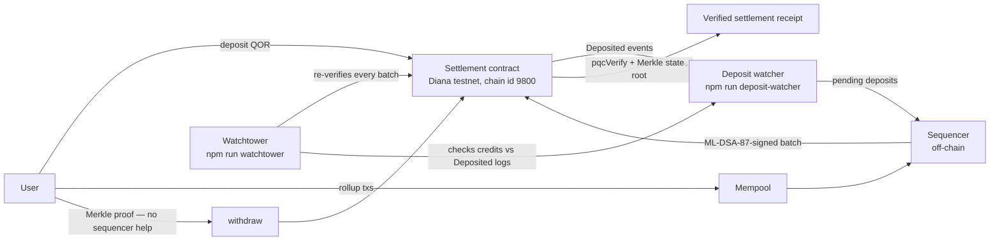

# QoreRollup

A minimal post-quantum rollup on QoreChain — a Protocol Builders entry
for the QoreChain Developer Fest ("Build Before Q-Day").

**Status:** live on the Diana testnet (v2). Settlement contract
deployed, 5 batches settled with ML-DSA-87 signatures verified
on-chain, L1 deposits flow into rollup balances automatically via the
deposit watcher (no hand-seeding), a Merkle-proof withdrawal of
0.3 QOR closed the auto-deposit cycle, double-withdraw and
tampered-proof attacks reverted on-chain, and the watchtower verifies
all batches clean — including the deposit credit check.

- Project page: https://build.qorechain.io/p/qorerollup
- Demo site: https://andipangeranm142.github.io/qorerollup/
- Demo video: [docs/demo.mp4](docs/demo.mp4) (2:50, narrated in English — 5 batches,
  three full cycles including a fresh-account cycle, Merkle-proof
  withdrawal, reverted attacks, watchtower). Also on YouTube
  (previous 4-batch cut; new upload pending):
  https://www.youtube.com/watch?v=b4m2iZkBjIw

## Team

- **Andi Pangeran** ([@andiPangeranm142](https://github.com/andiPangeranm142)) — Indonesia
- **Ajeng Ayu Kusuma** ([@Ajengayukusu](https://github.com/Ajengayukusu)) — Indonesia

## Concept

QoreRollup is a minimal rollup that batches transactions off-chain and
settles them on the QoreChain Diana testnet with post-quantum security:

- An off-chain sequencer collects transactions into batches.
- Each batch is signed with **ML-DSA-87** (post-quantum signatures).
- A settlement contract on Diana verifies the batch signature
  (via the `pqcVerify` precompile, against the sequencer's REGISTERED
  key from the `pqcKeyStatus` precompile) and records the batch's
  Merkle state root, issuing a **verified settlement receipt**.
- **Withdrawals** are proven against a settled batch's Merkle state
  root: any account withdraws its own rollup balance by presenting a
  Merkle proof for its leaf — directly, with **no sequencer help**.
  The sequencer cannot block a withdrawal. A cumulative per-account
  cap (`withdrawnAmount`) means the total ever withdrawn can never
  exceed the largest leaf balance proven, so withdrawing against
  several batch roots cannot double-spend.
- A **watchtower** re-verifies every batch (signature, state replay,
  Merkle tree + every leaf's proof, receipt, decrypt check) and flags
  invalid ones — including a deposit credit check: every credited
  deposit is matched against the on-chain `Deposited` logs, and the
  credited total is checked against `totalDeposited` in aggregate and
  per depositor.
- **Automatic deposit ingestion:** the deposit watcher reads
  `Deposited` events from the settlement contract and credits the
  depositor's rollup balance in the next batch — idempotently, so a
  deposit is never credited twice. The sequencer re-verifies every
  pending deposit against the chain before settling, and the
  watchtower re-checks every credit after settlement.
- Batch payloads are sealed with **ML-KEM-1024** (+ AES-256-GCM);
  the on-chain commitment is to the ciphertext.
- A **threat model** ([THREAT_MODEL.md](THREAT_MODEL.md)) documents the
  attack surface and mitigations — including what is demo-grade.

## Category requirements (Protocol Builders)

- [x] ML-DSA-signed batches — every settled batch carries a 4,627-byte
  ML-DSA-87 signature, verified on-chain via `pqcVerify`.
- [x] Withdrawal — 0.05 QOR withdrawn on-chain by an independent user
  wallet with a Merkle proof against batch #2's state root, no
  sequencer involvement (see Live usage). The same call sent twice
  REVERTED on-chain (`ZeroWithdraw`), and a call with one flipped hex
  char in the proof REVERTED on-chain (`InvalidMerkleProof`). A second
  withdrawal closed the auto-deposit cycle: the deployer withdrew
  0.3 QOR against batch #3's state root — its full leaf balance,
  which includes the auto-credited 0.1 QOR deposit — again with no
  sequencer involvement. A third withdrawal followed the
  [OUTSIDER_TEST.md](OUTSIDER_TEST.md) guide end to end: a fresh
  account deposited 0.05 QOR, batch #4 credited it, and the account
  withdrew the full 0.05 QOR against batch #4's state root — again
  with no sequencer involvement. (Run by the builder as a
  fresh-account test, not an independent outsider test.)
- [x] Verified settlement receipt — each batch gets a `receiptHash`
  (`keccak256("QoreRollup.receipt", chainid, contract, batchId,
  stateRoot, txDataCommitment)`), emitted in `BatchSettled` and
  re-verified by the watchtower.
- [x] Watchtower — `npm run watchtower` verifies all 5 batches OK
  (signature, state replay, Merkle tree + proofs, receipt, decrypt
  check, genesis-funding cross-check, deposit credit check — every
  credited deposit matched against the on-chain `Deposited` logs,
  and the credited total checked against `totalDeposited` in
  aggregate and per depositor). Tampered batches are detected
  (see tests) — and demonstrated live: flipping one hex char in a
  batch file's claimed state root made the watchtower FAIL that batch
  on eight independent checks (file vs on-chain root, replayed root,
  leaves-recomputed root, all four leaf proofs, decrypted payload)
  and FAIL the next batch on the broken chain; restoring the file
  byte-identical returned ALL BATCHES OK. The deposit checks were
  demonstrated the same way: inflating batch #3's claimed deposit by
  1 uqor made the watchtower FAIL it ("the credit EXCEEDS its
  deposit"), and naming a fake deposit tx made it FAIL on the fake
  credit even though the batch otherwise verified clean. Every run
  is appended to the verification log
  ([deployments/watchtower-log.json](deployments/watchtower-log.json)),
  with the contract address on each entry so v1 and v2 runs are
  distinguishable.
- [x] ML-KEM data protection — batch payloads sealed with ML-KEM-1024
  + AES-256-GCM; public key in
  [deployments/kem-public-key.json](deployments/kem-public-key.json),
  secret key held by the operator outside the repo.
- [x] Threat model — [THREAT_MODEL.md](THREAT_MODEL.md).

## Live deployment (Diana testnet, chain id 9800)

- **Settlement contract (v2):** `0xb54a8bd2dfffa9f3b8a23c3b4e663fe31667d708`
  ([explorer](https://explore.qore.network/address/0xb54a8bd2dfffa9f3b8a23c3b4e663fe31667d708) — switch to Testnet)
  Native form (for the project page testnet field): `qor1k49gh5kll75l8w9z8sa5ue3luvtx04cg75dhf9`
- **Deployer = sequencer:** `0x0140a056ee37D5240b0397eCdF1347Da80E33b9f`
  (`qor1q9q2q4hwxl2jgzcrjlkd7y68m2qwxwul0nheda`)
- **Demo user wallet** (independent of the sequencer):
  `0x29cb5ABD4309b5A83A6A66e95CbdA1d88F060d4F`
  (`qor19894402rpx66swn2vm54e0dpmz8svr20a952gv`), funded with 2 QOR
  (Cosmos `219FD783C30500EF438F29AC4B6520B2D6609B49DAC4107EA091B1FDF2C07889`),
  own ML-DSA-87 key registered
  (Cosmos `977B19B645464EB918D49FD09A780440C46393DDE6B12E32F770787DC16CEBE8`).
- **Deploy tx:** `0x9f8032e00d66000ff427868c9c57a27ee006d769d1c797b5936457c280022cd0`
  (Cosmos `5DFEEF53AEFBD5F23FA3DA9DC6F47D7168B5A91DEB75843211CA4470E4713510`,
  block 10250134). Bytecode: 3,877 bytes.
- **ML-KEM-1024 data key:** public key hash
  `0xf2ef384e0592c94dbc9b70b175eb8731432bdf0040581aac3d24797bbf8bf862`
  (see [deployments/kem-public-key.json](deployments/kem-public-key.json);
  the v1 keypair was reused, never regenerated).

**v1 superseded.** The first settlement contract,
`0x96051b69a7d0e2236a3fe2e51fe33a55367d36c2`, is superseded by v2: its
withdrawals checked the L1 deposit ledger with a per-withdrawal
nullifier, and its state root was a plain hash commitment with no
inclusion proofs — so a user could not withdraw on the basis of their
rollup balance at all. v2's state root is a Merkle root and withdrawals
are proven against it. The v1 history (3 batches, 1 withdrawal, 1
forged-batch revert) is real on-chain activity and is archived in
[deployments/v1/](deployments/v1/).

## Live usage (17 Nov 2026, all on Diana)

Full step log with hashes: [deployments/usage.json](deployments/usage.json).
Per-batch detail (txs, state roots, leaves, proofs, signatures,
ciphertexts): [deployments/batches/](deployments/batches/).

| Step | Detail | EVM tx | Cosmos tx (explorer) | Block | Status |
| --- | --- | --- | --- | --- | --- |
| Deploy | Settlement contract v2 deployed (3,877 bytes) | `0x9f8032e00d66000ff427868c9c57a27ee006d769d1c797b5936457c280022cd0` | [`5DFEEF53AEFBD5F23FA3DA9DC6F47D7168B5A91DEB75843211CA4470E4713510`](https://explore.qore.network/tx/5DFEEF53AEFBD5F23FA3DA9DC6F47D7168B5A91DEB75843211CA4470E4713510) | 10250134 | Success |
| Deposit | 0.3 QOR into the rollup (genesis deposit, hand-credited before batch #0) | `0x0a39abcbd8307280e19f3e035bbbde29a36804b865da95f74d6fac4dd73ee2a5` | [`2BA3C0DEEE93538EBE431F378F5DD90BD90DF594CBC87F75182D800AED71B6CE`](https://explore.qore.network/tx/2BA3C0DEEE93538EBE431F378F5DD90BD90DF594CBC87F75182D800AED71B6CE) | 10250139 | Success |
| Batch #0 | 1 tx: deployer → user wallet, 50,000 uqor (2 leaves) | `0x192d42f9ce32dad3e16dd031bcd8e52b8de03edffbb1f8b3ab7f9373d1774382` | [`796B8BEDE0AD1958AD93E708A14FFEFF601FF0330DE25A312FD7390E57C23CDF`](https://explore.qore.network/tx/796B8BEDE0AD1958AD93E708A14FFEFF601FF0330DE25A312FD7390E57C23CDF) | 10250155 | Success |
| Batch #1 | 2 txs: deployer → `0x1111…1111` 25,000; `0x1111…1111` → `0x2222…2222` 10,000 uqor (4 leaves) | `0x2604ab6a838cc66c8c0b22f8198aa8fa630333b93616287c016d97e37abfa5ef` | [`C380154DF477DA64A7C985DBEF991A09E3AB25478E171DD43252FC6E54993998`](https://explore.qore.network/tx/C380154DF477DA64A7C985DBEF991A09E3AB25478E171DD43252FC6E54993998) | 10250169 | Success |
| Batch #2 | 1 tx: deployer → `0x3333…3333`, 15,000 uqor (5 leaves) | `0xf6ff9ad564f9c2214203a49f3c3747414b554fc61fa4e46d7b000f0d40c412a0` | [`F19BC134228AF2E3EE9BB0B90E4CEA90DE7C74E95A250DB62802EEC9FF7E9FB6`](https://explore.qore.network/tx/F19BC134228AF2E3EE9BB0B90E4CEA90DE7C74E95A250DB62802EEC9FF7E9FB6) | 10250179 | Success |
| **Merkle withdrawal** | **User wallet withdraws 0.05 QOR with a 3-element Merkle proof against batch #2 — no sequencer involvement** | `0xaa57f3b235d317dc8d2caf2f2444ff0b27822145042490484dbda2bc8c33fc14` | [`681E9D192A38ABB9D3F13DD1091015C07C01DB7B863E3295D825D032EF4591DD`](https://explore.qore.network/tx/681E9D192A38ABB9D3F13DD1091015C07C01DB7B863E3295D825D032EF4591DD) | 10250197 | Success |
| **Double-withdraw (attack demo)** | Same Merkle-proof withdrawal sent again — **REVERTED on-chain** (`ZeroWithdraw`), cumulative cap unchanged | `0x1da16ddeeea2b9fa5f456911b36ed615b20b7b551491f2a94b81a532b177a86d` | [`439BF165BDF6A751DEBBC6F94F41ED2F633E9EC77931DB72DAB8F477796E8628`](https://explore.qore.network/tx/439BF165BDF6A751DEBBC6F94F41ED2F633E9EC77931DB72DAB8F477796E8628) | 10250203 | **Reverted** |
| **Tampered-proof (attack demo)** | Withdrawal with one flipped hex char in the proof — **REVERTED on-chain** (`InvalidMerkleProof`) | `0x35715e361b5289e5d4259ea705a56f58c07f1d993323efce8eb946551a076519` | [`E4B4E3900E0123259C53CD711C026B209ACD09AA743AAA0F28409D2D3EDFC7ED`](https://explore.qore.network/tx/E4B4E3900E0123259C53CD711C026B209ACD09AA743AAA0F28409D2D3EDFC7ED) | 10250208 | **Reverted** |
| **Forged batch (attack demo)** | Genuine ML-DSA-87 signature over the WRONG digest, submitted by the sequencer itself — **REVERTED on-chain** (`InvalidBatchSignature`), `batchCount` unchanged | `0x2fbb8444db842c419b180dc5b34b64b4b636b2c4b1199faedc025558f6d206f3` | [`4601E15374FF6AD15B3458466549EA9E370E74B82ED2BE10F291C15E8DE52141`](https://explore.qore.network/tx/4601E15374FF6AD15B3458466549EA9E370E74B82ED2BE10F291C15E8DE52141) | 10250217 | **Reverted** |
| Deposit (auto-credit cycle) | 0.1 QOR into the rollup — picked up by the deposit watcher and credited by batch #3 | `0x3c37b8f32daa3b42090a4a16121be141a2ec33747467f879d8b69028275bd08e` | [`D1BF023F9C1BCB84831ABDB86DFF3098A257936D6DE103A8DDA281B04DD655D9`](https://explore.qore.network/tx/D1BF023F9C1BCB84831ABDB86DFF3098A257936D6DE103A8DDA281B04DD655D9) | 10252674 | Success |
| Batch #3 | 1 deposit (100,000 uqor, auto-credited) + 1 tx: deployer → user wallet, 10,000 uqor (5 leaves) | `0xb0d9842996e735efe3d842fae71309625bd75ceab8c61628224c0f12e560391c` | [`E0E7F28A654A162FA5822356C25FD3639A24775367A7E928A12C256508EFA818`](https://explore.qore.network/tx/E0E7F28A654A162FA5822356C25FD3639A24775367A7E928A12C256508EFA818) | 10252704 | Success |
| **Merkle withdrawal (auto-credit cycle)** | **Deployer withdraws 0.3 QOR with a 3-element Merkle proof against batch #3 — its full leaf balance, which includes the auto-credited 0.1 QOR deposit; no sequencer involvement** | `0x926d52875bffc10bc5ad3577f740b4e41641c34444972092241521363d0a6a91` | [`B11F3986401D66598A1DF23CCEF90E7FA807A385C3D2F406AC96F8DA626640FB`](https://explore.qore.network/tx/B11F3986401D66598A1DF23CCEF90E7FA807A385C3D2F406AC96F8DA626640FB) | 10253087 | Success |
| Deposit (fresh-account test) | 0.05 QOR from a fresh account — picked up by the deposit watcher and credited by batch #4 | `0xba8dbf221d8db7c4045d67e58df1470a041a0b396bd77811692223befde6592b` | [`C9DDAC126294617E2A53EED7C09EDDD060C2CF6330C161586899A8E129A25C45`](https://explore.qore.network/tx/C9DDAC126294617E2A53EED7C09EDDD060C2CF6330C161586899A8E129A25C45) | 10256490 | Success |
| Batch #4 | 1 deposit (50,000 uqor, auto-credited) + 1 tx: sequencer self-transfer, 1 uqor (6 leaves) | `0x3dc38a1ca1a71b8bb86325b19ce65eee7a1a33df073a700dc30aa431737b56c9` | [`2B760E67ADE8D0741BA85E203D1261304661ABCE36FF904933B4705F8508FEDD`](https://explore.qore.network/tx/2B760E67ADE8D0741BA85E203D1261304661ABCE36FF904933B4705F8508FEDD) | 10256512 | Success |
| **Merkle withdrawal (fresh-account test)** | **Fresh account withdraws 0.05 QOR with a Merkle proof against batch #4 — its full leaf balance; no sequencer involvement** | `0x231d3a550bc5ecdf5e9ff5a52cf7877d6712619a3b5ed81a55db8d8965b17798` | [`F80120317E7183546501F3962AE519370E70213DDE93857BB3DF58B4DAEB1196`](https://explore.qore.network/tx/F80120317E7183546501F3962AE519370E70213DDE93857BB3DF58B4DAEB1196) | 10256530 | Success |

Note on the fresh-account test (17 Nov 2026): the deposit, batch #4
and withdrawal above followed [OUTSIDER_TEST.md](OUTSIDER_TEST.md)
end to end, but were run by the builder with a fresh wallet — this is
a fresh-account test, NOT an independent outsider test. A genuinely
independent tester has not tried the project yet.

Every transaction above has two hash forms: the EVM hash (as returned
by the RPC) and the Cosmos/native hash (as shown by the explorer — the
explorer links use it). The same hashes are recorded in
[deployments/usage.json](deployments/usage.json) and
[deployments/testnet.json](deployments/testnet.json).

Final on-chain state (verified by independent read): `batchCount` 5,
`totalDeposited` 0.45 QOR, `totalWithdrawn` 0.40 QOR,
`withdrawnAmount[deployer]` 300,000 uqor, `withdrawnAmount[user]`
50,000 uqor, `withdrawnAmount[fresh test account]` 50,000 uqor,
`deposits[deployer]` 0.4 QOR, `deposits[fresh test account]` 0.05 QOR
(v2 withdrawals do not touch the L1 deposit ledger), contract balance
0.05 QOR. Final rollup balances: deployer 300,000 uqor, user wallet
60,000, `0x1111…1111` 15,000, `0x2222…2222` 10,000,
`0x3333…3333` 15,000, fresh test account 50,000 (total 450,000 —
conserved from the 0.45 QOR deposited). Solvency: the remaining
withdrawable amounts (leaf balance minus `withdrawnAmount` per
account) total exactly 50,000 uqor — the contract's balance.

L1 deposits are auto-credited: the deposit watcher
(`npm run deposit-watcher`) reads `Deposited` events from the
settlement contract, records them in `deployments/deposits.json`
(identified by transaction hash + log index, so re-runs never credit
twice), and the sequencer applies the pending ones into the next
batch's state transition — deposits first, then the mempool txs. The
0.1 QOR deposit in the table above was credited exactly this way:
deposit tx `0x3c37b8f32daa3b42090a4a16121be141a2ec33747467f879d8b69028275bd08e`
(Cosmos `D1BF023F9C1BCB84831ABDB86DFF3098A257936D6DE103A8DDA281B04DD655D9`,
block 10252674), watcher run recorded in `deployments/usage.json`,
credited by batch #3
(`0xb0d9842996e735efe3d842fae71309625bd75ceab8c61628224c0f12e560391c`,
Cosmos `E0E7F28A654A162FA5822356C25FD3639A24775367A7E928A12C256508EFA818`,
block 10252704), and the cycle closed with the deployer's 0.3 QOR
Merkle-proof withdrawal against batch #3
(`0x926d52875bffc10bc5ad3577f740b4e41641c34444972092241521363d0a6a91`,
Cosmos `B11F3986401D66598A1DF23CCEF90E7FA807A385C3D2F406AC96F8DA626640FB`,
block 10253087). The 0.3 QOR genesis deposit is the one exception:
it was credited by hand before batch #0, before the watcher existed,
and is recorded in `deployments/deposits.json` with status "genesis"
so it is never credited twice. No manual seeding exists in the live
path — the sequencer refuses to settle without `deposits.json`, and
re-verifies every pending deposit against the on-chain logs before
crediting it. The watchtower re-checks every credit after settlement
(see [THREAT_MODEL.md](THREAT_MODEL.md) §4.13): a credit larger than
its supporting L1 deposit fails the run. The watcher runs on its own
every 30 minutes (a scheduled job, since 17 Nov 2026) — deposits are
picked up without any operator action; every run is recorded in
`deployments/usage.json`, and the run log is committed to the repo
daily.

## How to verify yourself

Nothing in the table above needs to be taken on trust — every claim
can be checked independently:

1. **Check the transactions on the explorer.** Open
   https://explore.qore.network and **switch to Testnet first** — the
   explorer defaults to Mainnet, and none of these transactions will
   show up until you switch. Then paste any Cosmos hash from the
   table into the search box (or click its link): you will see the
   transaction, its block number, and whether it succeeded or
   reverted. The three attack demos (double-withdraw, tampered
   proof, forged batch) show as failed transactions at blocks
   10250203, 10250208 and 10250217.
2. **Check the contract state.** Open the settlement contract
   `0xb54a8bd2dfffa9f3b8a23c3b4e663fe31667d708` on the explorer
   (Testnet): `batchCount` 5, `totalDeposited` 0.45 QOR,
   `totalWithdrawn` 0.40 QOR, contract balance 0.05 QOR.
3. **Re-run the tests.** `npm install && npm test` — 150 tests pass
   (Hardhat; the contract tests run against mock precompiles, the
   off-chain tests use real ML-DSA-87 and ML-KEM-1024 crypto).
4. **Re-run the watchtower.** `npm run watchtower` re-verifies all 5
   settled batches against the on-chain records — signatures, state
   replay, Merkle trees and proofs, receipts, decrypt check, and the
   deposit credit checks — and prints ALL BATCHES OK. It needs only
   a Diana RPC endpoint (defaults to `https://evm-testnet.qore.host`);
   no keys are required. Every run is appended to
   [deployments/watchtower-log.json](deployments/watchtower-log.json).

## How it works



In more detail:

```
L1 deposits ──► deposit watcher (npm run deposit-watcher) reads
                 `Deposited` events ──► deployments/deposits.json
                 (pending → settled by the next batch)

User txs ──► mempool (deployments/mempool.json)
                │  npm run sequencer settle
                ▼
Sequencer builds a batch: applies pending deposits first, then the
mempool txs, to the rollup state; computes the new Merkle state root
+ tx-data commitment, seals the batch payload with ML-KEM-1024,
signs the batch digest with ML-DSA-87 (pqcSign)
                │  hybrid-signed EVM tx (needs an open EVM window)
                ▼
QoreRollup.submitBatch: checks the caller is the sequencer, reads the
sequencer's REGISTERED ML-DSA key from pqcKeyStatus (0x0A02), verifies
the signature via pqcVerify (0x0A01), records the batch + receiptHash
                │
                ▼
Watchtower (npm run watchtower) re-verifies every batch off-chain:
signature vs the registered key, state replay, Merkle tree + proofs,
receipt, decrypt check, deposit credits vs the on-chain logs.

Withdrawals (no sequencer): the user reads their leaf + proof from the
published batch file and calls QoreRollup.withdraw(batchId, account,
balance, nonce, proof) themselves. The contract verifies the proof
against the settled Merkle root and pays balance − withdrawnAmount.
```

State root: a Merkle root over the post-batch state — one leaf per
non-zero balance, leaf = `keccak256(account, balance, nonce)`, binary
tree with sorted pairs (OpenZeppelin MerkleProof convention). Each
batch file stores the leaves and every account's proof, so any account
can withdraw with no sequencer help. See
[THREAT_MODEL.md](THREAT_MODEL.md) for the full list of demo-grade
simplifications — including the honest data-availability caveat: if
ALL batch data were withheld, a user could not construct a proof.

## Run it yourself (testnet only)

Outsider? Follow [OUTSIDER_TEST.md](OUTSIDER_TEST.md) to deposit and
withdraw with your own wallet — no team keys involved.

Prerequisites: Node.js 20+, a funded Diana testnet account in `../.env`
(`QORE_MNEMONIC`, `QORE_EVM_PRIVATE_KEY`, `QORE_EVM_RPC_URL` —
mode 600, outside the repo; see `.env.example`). Never commit real keys.

```sh
npm install
npm run compile
npm test                    # 150 tests (34 contract + 15 merkle + 23 sequencer + 18 watchtower + 10 KEM + 27 deposit-watcher + 23 deposit-credit)
npm run window register     # register the account's ML-DSA-87 key (once)
npm run window open         # open an EVM authorisation window
npm run deploy              # deploy the settlement contract
npm run sequencer keygen    # generate the rollup ML-KEM-1024 data keypair
npm run usage -- deposit --amount 300000     # deposit 0.3 QOR
npm run deposit-watcher                      # ingest the deposit (auto-credit; idempotent)
npm run sequencer -- enqueue --from <0x> --to <0x> --amount <uqor>
npm run sequencer -- settle    # settle the mempool as one ML-DSA-signed batch
npm run merkle-withdraw -- --batch <id> [--dry-run]   # withdraw with a Merkle proof (uses ../.env.user)
npm run watchtower          # re-verify every settled batch
npm run forged-batch        # attack demo: submit a batch with a forged
                            # ML-DSA-87 signature — must REVERT on-chain
npm run sequencer status    # contract + local state, read-only
```

## Tests

- `npm test` — 150 passing: 34 contract tests (Hardhat, mock
  precompiles installed at 0x0A01/0x0A02 via `hardhat_setCode`,
  including Merkle-proof withdrawals proven with the TypeScript tree
  against the contract), 66 merkle/sequencer/watchtower/KEM tests
  (Merkle tree + proofs incl. odd leaf counts, state transitions,
  digest formulas, KEM round-trip + tamper detection, watchtower
  detection of tampered batches — bad state root, bad signature,
  tampered txs, tampered leaves/proofs, tampered ciphertext, wrong
  receipt), 27 deposit-watcher tests (event parsing, idempotent
  credit, no double-credit on re-run, deposit-aware batch
  verification with real ML-DSA-87 + ML-KEM crypto), and 23
  deposit-credit tests — the negative cases: a fake credit and a
  credit exceeding its supporting deposit fail at both the
  watcher/sequencer level and the watchtower level.
- `npm run typecheck` — clean.

## AI usage

Built with AI assistance (Muse Spark) under human direction. See
[AI_USAGE.md](AI_USAGE.md). All on-chain evidence is real Diana
testnet activity; nothing in the usage table is simulated.

## Licence

Apache-2.0
